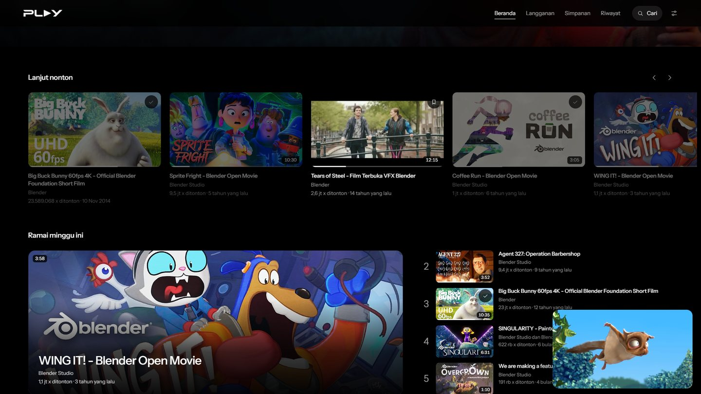
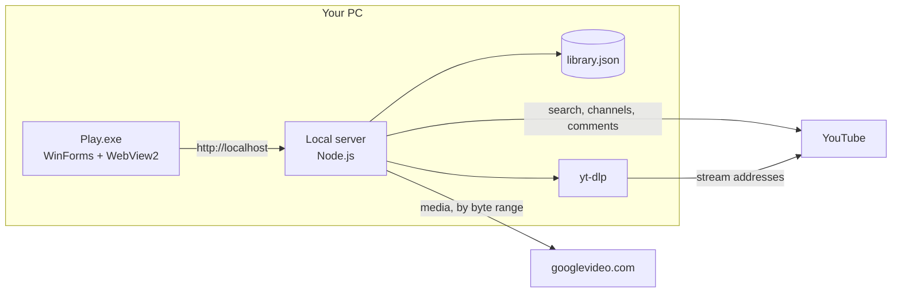

<p align="center">
  
</p>

<p align="center">
  A personal YouTube player for Windows, without the ads.
</p>

<p align="center">
  <a href="https://github.com/Hiroyki/play/releases/latest">Download</a> ·
  <a href="#install">Install</a> ·
  <a href="#run-from-source">Run from source</a> ·
  <a href="#build">Build</a> ·
  <a href="#how-it-works">How it works</a>
</p>


Play opens YouTube videos in its own window and plays the media stream directly, so pre-roll and mid-roll ads are never requested. It runs on one PC, keeps your data on that PC, and needs no YouTube account. Sponsor segments that creators record into a video are part of the stream and still play.

> [!IMPORTANT]
> Play is for personal use. Fetching streams directly is against the YouTube Terms of Service, so do not host it publicly.

## Features

- **Playback:** up to 4K AV1 where the hardware decodes it efficiently and H.264 otherwise, live streams, subtitles, chapters, speed, autoplay, and resume.
- **Player:** quality switching without a rebuffer, thumbnails on the seek bar, a curve of the most replayed parts, and ambient light that follows the scene.
- **Browsing:** search, channels, playlists, comments, nine topics, and weekly rankings. Pasting a YouTube link opens it.
- **Continuity:** the video shrinks into a corner player while you browse and keeps playing.
- **Your data:** subscriptions, saved videos, and history live in one JSON file, with daily backups, export, and import.
- **Windows integration:** native window, taskbar playback buttons, and a single instance that accepts YouTube links as an argument.

| Watch page | Quality menu | Corner player |
|---|---|---|
|  |  |  |

## Install

1. Download `Play-Setup-<version>.exe` from [Releases](https://github.com/Hiroyki/play/releases/latest).
2. Check that its SHA-256 matches the one in the release notes.
3. Run it. No administrator rights are needed; Play is installed to `%LOCALAPPDATA%\Programs\Play`.

Requirements: 64-bit Windows 11, where Play is tested. Windows 10 is untested and needs the [WebView2 Runtime](https://developer.microsoft.com/microsoft-edge/webview2/).

The installer contains Node.js. If the PC has no yt-dlp, Play downloads the official release on first start and verifies its SHA-256 before using it.

The installer is not code-signed, so SmartScreen shows a warning.

To remove Play, use **Settings > Apps**. Your data stays in `%LOCALAPPDATA%\Play`.

## Run from source

You need Node.js 22 or later and [yt-dlp](https://github.com/yt-dlp/yt-dlp) on `PATH`.

```powershell
npm install
npm start
```

Open `http://localhost:4321`. This copy keeps its data in `data`, separate from an installed copy. To move between the two, use Export and Import in Settings.

## Build

The build uses `csc.exe`, the C# compiler included with Windows, and the `Microsoft.Web.WebView2` SDK from the NuGet cache. It stops if a WebView2 file is not signed by Microsoft.

| Command | Output |
|---|---|
| `powershell -ExecutionPolicy Bypass -File windows\build.ps1` | `Play.exe` in the repository root |
| `powershell -ExecutionPolicy Bypass -File windows\installer.ps1` | `dist\Play-Setup-<version>.exe` |

The version comes from `package.json`. The installer script also stops if user data ends up in the package.

## How it works



`Play.exe` starts the server on a loopback port and stops it on exit, even after a crash. The server finds the stream addresses with yt-dlp, reads the MP4 index, and serves a DASH manifest. [Shaka Player](https://github.com/shaka-project/shaka-player) then requests only the byte ranges it needs.

YouTube activates some stream addresses a few seconds after issuing them. Play waits for that moment, and prepares videos you hover over so they can start sooner.

### Privacy and security

- The server listens on `127.0.0.1` and rejects requests with a foreign `Host` or `Origin`.
- The media proxy accepts only video IDs and `googlevideo.com` addresses.
- Text from YouTube is inserted as text, never as HTML, under a content security policy.
- The app contacts YouTube and its image hosts, PyPI to check the yt-dlp version, and GitHub when it installs yt-dlp.

### Layout

| Path | Contents |
|---|---|
| `server/youtube.js` | Search, channels, playlists, comments, home page |
| `server/stream.js` | Stream lookup, DASH and HLS, media proxy, subtitles |
| `server/ytdlp.js` | Finding, installing, and updating yt-dlp |
| `server/library.js` | User data, backups, import |
| `public` | Interface; plain JavaScript and CSS with no build step |
| `windows/Play.cs` | Native window and server lifecycle |
| `windows/Setup.cs` | Installer |

## Keyboard shortcuts

| Key | Action |
|---|---|
| `Space` or `K` | Play or pause |
| `J` / `L` | Back or forward 10 seconds |
| `←` / `→` | Back or forward 5 seconds |
| `↑` / `↓` | Volume |
| `0` to `9` | Jump to 0% to 90% |
| `<` / `>` | Speed |
| `M`, `C`, `F`, `T`, `I` | Mute, subtitles, full screen, wide mode, picture in picture |
| `Shift+N` | Next video |
| `/` or `Ctrl+K` | Search (`Ctrl+K` in the Windows app) |
| `Alt+←` / `Alt+→` | Back or forward (Windows app) |
| `F5`, `F11` | Reload, full screen (Windows app) |

## Configuration

| Variable | Default | Usage |
|---|---|---|
| `PORT` | `4321` | Server port |
| `PLAY_LIBRARY` | `data/library.json` | User data file; backups go to `cadangan` beside it |
| `PLAY_BIN` | `data/bin` | Where Play stores its own yt-dlp |
| `PLAY_INSTALLED` | unset | When set, a missing yt-dlp is installed on start |
| `PLAY_YTDLP_URL` | latest yt-dlp release on GitHub | Download source for yt-dlp |
| `YTDLP` | unset | Path to a specific yt-dlp |

## Known limits

- Private, members-only, and age-restricted videos do not play, because Play does not sign in to YouTube.
- Starting a video that was not prepared took 8.5 to 12.6 seconds in testing; a prepared one took 0.6 to 1.6 seconds.
- YouTube changes can break playback until yt-dlp is updated. Settings shows when a newer version exists.
- Shorts are hidden from lists, but a Shorts link opens normally.
- The interface is in Indonesian.

## Credits

Play is built on [yt-dlp](https://github.com/yt-dlp/yt-dlp), [YouTube.js](https://github.com/LuanRT/YouTube.js), [Shaka Player](https://github.com/shaka-project/shaka-player), [Express](https://expressjs.com), and [Instrument Sans](https://github.com/Instrument/instrument-sans). Screenshots show open movies by the [Blender Foundation](https://studio.blender.org/films/), licensed CC BY.

Play is not affiliated with YouTube or Google.
