<a id="top"></a>

<p align="center">
  
</p>

<p align="center">
  <a href="https://github.com/Hiroyki/play/releases/latest"></a>&nbsp;
  <a href="#move"></a>&nbsp;
  <a href="#inside"></a>
</p>

Play opens YouTube videos in its own window and plays the media stream directly, so pre-roll and mid-roll ads are never requested. It runs on one PC, keeps your data there, and needs no account.

<p align="center">
  
</p>

<p align="center">
  
</p>

> [!IMPORTANT]
> Play is for personal use. Fetching streams directly is against the YouTube Terms of Service, so do not host it publicly.

<h2><a id="move"></a></h2>

<table>
  <tr>
    <td width="50%" valign="top">
      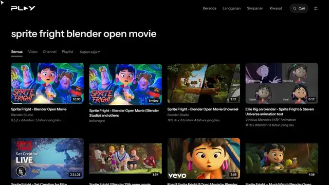<br>
      <b>It follows you</b><br>
      <sub>The thumbnail becomes the player, and the player shrinks into the corner while you browse.</sub>
    </td>
    <td width="50%" valign="top">
      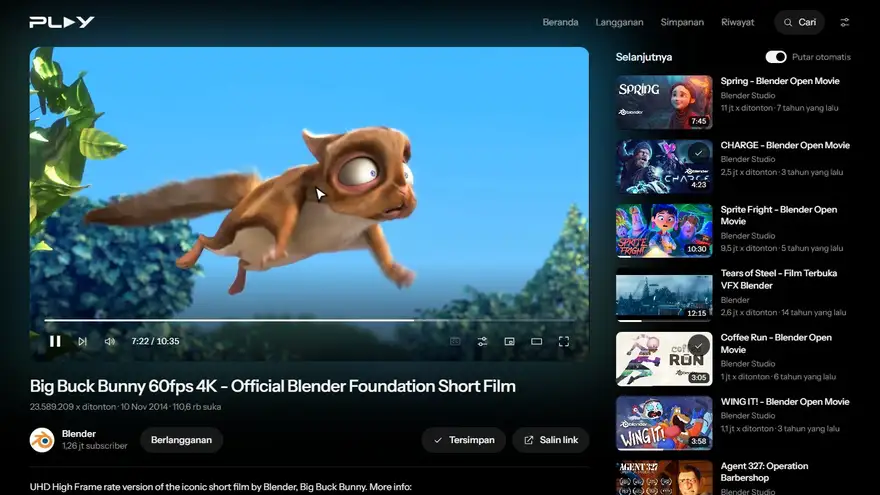<br>
      <b>Scrub with pictures</b><br>
      <sub>Previews along the seek bar. Switching from 360p to 2160p caused 0 ms of rebuffering in testing.</sub>
    </td>
  </tr>
  <tr>
    <td width="50%" valign="top">
      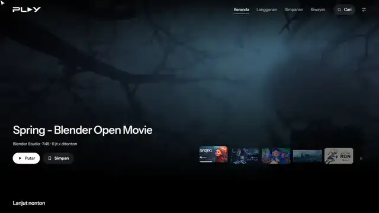<br>
      <b>Search from anywhere</b><br>
      <sub>Press <kbd>/</kbd>, type, or paste a YouTube link.</sub>
    </td>
    <td width="50%" valign="top">
      <br>
      <b>Hover first, start sooner</b><br>
      <sub>Play prepares a video under the pointer. The bars run in real time and show the slowest start of each kind in testing.</sub>
    </td>
  </tr>
</table>

<h2><a id="get"></a></h2>

<table>
  <tr>
    <td width="33%" valign="top">
      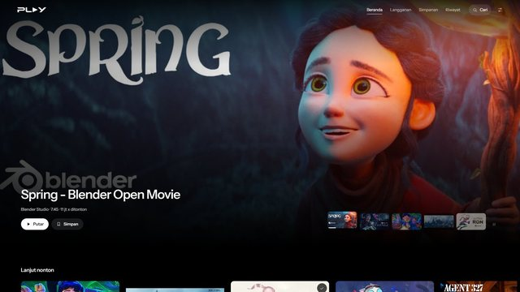<br>
      <b>Home</b><br>
      <sub>Highlights with silent previews, continue watching, and a shelf for the time of day.</sub>
    </td>
    <td width="33%" valign="top">
      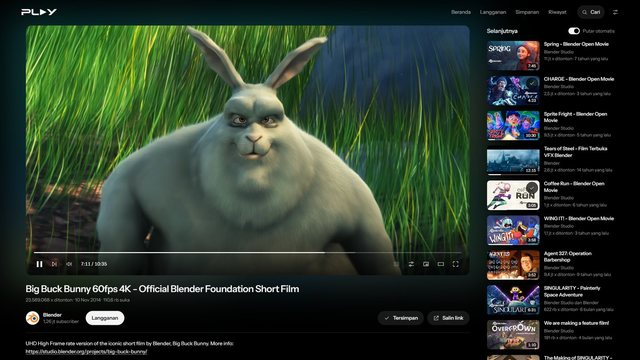<br>
      <b>Watch</b><br>
      <sub>Soft light follows the picture. Subtitles, chapters, speed, resume, live.</sub>
    </td>
    <td width="33%" valign="top">
      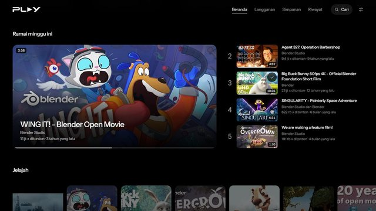<br>
      <b>Explore</b><br>
      <sub>Weekly rankings and nine topics.</sub>
    </td>
  </tr>
  <tr>
    <td width="33%" valign="top">
      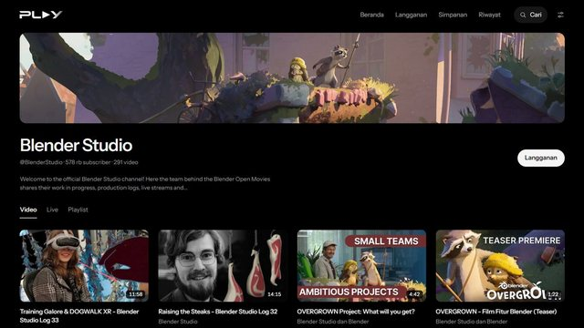<br>
      <b>Channels</b><br>
      <sub>Videos, live streams, playlists, and one page for subscriptions.</sub>
    </td>
    <td width="33%" valign="top">
      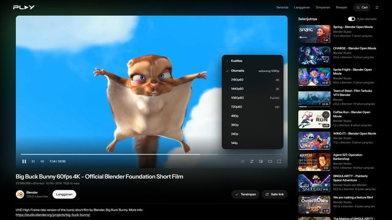<br>
      <b>Up to 4K</b><br>
      <sub>AV1 where the hardware decodes it efficiently, H.264 otherwise.</sub>
    </td>
    <td width="33%" valign="top">
      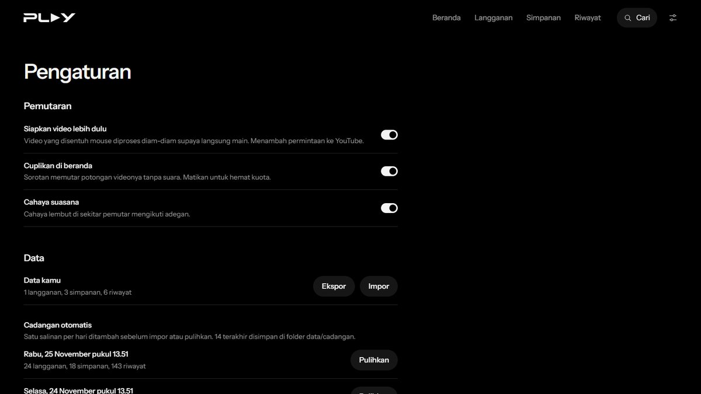<br>
      <b>Your data</b><br>
      <sub>One file on your PC, with daily backups, export, and import.</sub>
    </td>
  </tr>
</table>

Sponsor segments that creators record into a video are part of the stream and still play.

<h2><a id="install"></a></h2>

1. Download `Play-Setup-<version>.exe` from [Releases](https://github.com/Hiroyki/play/releases/latest).
2. Check that its SHA-256 matches the one in the release notes.
3. Run it. If SmartScreen shows "Windows protected your PC", choose **More info**, then **Run anyway**.
4. Follow the wizard: **Next**, choose a folder, **Install**, **Finish**. No administrator rights are needed; the default folder is `%LOCALAPPDATA%\Programs\Play`.

Requirements: 64-bit Windows 11, where Play is tested. Windows 10 is untested and needs the [WebView2 Runtime](https://developer.microsoft.com/microsoft-edge/webview2/).

If the PC has no yt-dlp, Play downloads the official release on first start, about 23 MB, and verifies its SHA-256 before using it. A video opened during the download waits and then starts by itself.

> [!NOTE]
> The installer is not code-signed. SmartScreen warns about it, and Smart App Control, where it is on, can block it without a way to continue.

To remove Play, use **Settings > Apps**. Your data stays in `%LOCALAPPDATA%\Play`.

<details>
<summary><b>Run from source instead</b></summary>

<br>

You need Node.js 22 or later and [yt-dlp](https://github.com/yt-dlp/yt-dlp) on `PATH`.

```powershell
npm install
npm start
```

Open `http://localhost:4321`. This copy keeps its data in `data`, separate from an installed copy. To move between the two, use Export and Import in Settings.

</details>

<h2><a id="inside"></a></h2>

<p align="center">
  
</p>

`Play.exe` starts the server on a loopback port and stops it on exit, even after a crash. The server finds stream addresses with yt-dlp, reads the MP4 index, and serves a DASH manifest, so the player requests only the byte ranges it needs.

<details>
<summary><b>What happens when you press play</b></summary>

<br>

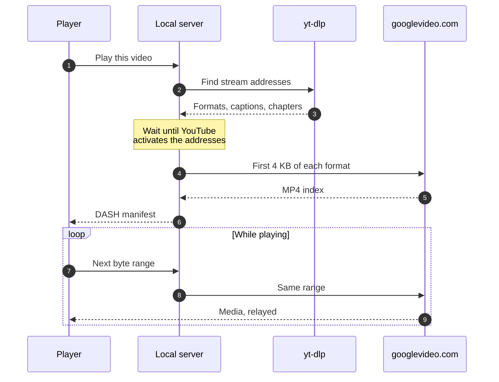

</details>

<details>
<summary><b>Privacy and security</b></summary>

<br>

- The server listens on `127.0.0.1` and rejects requests with a foreign `Host` or `Origin`.
- The media proxy accepts only video IDs and `googlevideo.com` addresses.
- Text from YouTube is inserted as text, never as HTML, under a content security policy.
- The app contacts YouTube and its image hosts, PyPI to check the yt-dlp version, and GitHub when it installs yt-dlp.

</details>

<details>
<summary><b>Project layout</b></summary>

<br>

| Path | Contents |
|---|---|
| `server/youtube.js` | Search, channels, playlists, comments, home page |
| `server/stream.js` | Stream lookup, DASH and HLS, media proxy, subtitles |
| `server/ytdlp.js` | Finding, installing, and updating yt-dlp |
| `server/library.js` | User data, backups, import |
| `public` | Interface; plain JavaScript and CSS with no build step |
| `windows/Play.cs` | Native window and server lifecycle |
| `windows/Setup.cs` | Installer |

</details>

<details>
<summary><b>Configuration</b></summary>

<br>

| Variable | Default | Usage |
|---|---|---|
| `PORT` | `4321` | Server port |
| `PLAY_LIBRARY` | `data/library.json` | User data file; backups go to `cadangan` beside it |
| `PLAY_BIN` | `data/bin` | Where Play stores its own yt-dlp |
| `PLAY_INSTALLED` | unset | When set, a missing yt-dlp is installed on start |
| `PLAY_YTDLP_URL` | latest yt-dlp release on GitHub | Download source for yt-dlp |
| `YTDLP` | unset | Path to a specific yt-dlp |

</details>

<details>
<summary><b>Build it yourself</b></summary>

<br>

The build uses `csc.exe`, the C# compiler included with Windows, and the `Microsoft.Web.WebView2` SDK from the NuGet cache. It stops if a WebView2 file is not signed by Microsoft.

| Command | Output |
|---|---|
| `powershell -ExecutionPolicy Bypass -File windows\build.ps1` | `Play.exe` in the repository root |
| `powershell -ExecutionPolicy Bypass -File windows\installer.ps1` | `dist\Play-Setup-<version>.exe` |

The version comes from `package.json`. The installer script also stops if user data ends up in the package.

</details>

<h2><a id="keys"></a></h2>

<p align="center">
  
</p>

<details>
<summary><b>Every shortcut as a list</b></summary>

<br>

| Playback | | Navigation | |
|---|---|---|---|
| <kbd>Space</kbd> <kbd>K</kbd> | Play or pause | <kbd>/</kbd> | Search |
| <kbd>J</kbd> <kbd>L</kbd> | 10 seconds back or forward | <kbd>Ctrl</kbd> <kbd>K</kbd> | Search, in the app |
| <kbd>←</kbd> <kbd>→</kbd> | 5 seconds back or forward | <kbd>Alt</kbd> <kbd>←</kbd> <kbd>→</kbd> | Back or forward, in the app |
| <kbd>↑</kbd> <kbd>↓</kbd> | Volume | <kbd>Shift</kbd> <kbd>N</kbd> | Next video |
| <kbd>0</kbd> to <kbd>9</kbd> | Jump to 0% to 90% | <kbd>F</kbd> | Full screen |
| <kbd>&lt;</kbd> <kbd>&gt;</kbd> | Speed | <kbd>T</kbd> | Wide mode |
| <kbd>M</kbd> | Mute | <kbd>I</kbd> | Picture in picture |
| <kbd>C</kbd> | Subtitles | <kbd>F5</kbd> <kbd>F11</kbd> | Reload, full screen, in the app |

</details>

<h2><a id="faq"></a></h2>

<details>
<summary><b>Why does a video sometimes take several seconds to start?</b></summary>

<br>

YouTube activates some stream addresses a few seconds after issuing them, and Play waits for that moment. Resting the pointer on a video first hides most of the wait.

</details>

<details>
<summary><b>A video stopped playing. What now?</b></summary>

<br>

YouTube changes often, and yt-dlp follows. Open Settings, which shows when a newer yt-dlp exists and can update the copy Play installed.

</details>

<details>
<summary><b>What does not work?</b></summary>

<br>

- Private, members-only, and age-restricted videos, because Play does not sign in to YouTube.
- Shorts are hidden from lists, but a Shorts link opens normally.
- The interface is in Indonesian only.

</details>

<details>
<summary><b>Can I open it on my phone?</b></summary>

<br>

No. The server accepts connections only from the PC it runs on.

</details>

<h2><a id="license"></a></h2>

<a href="LICENSE.md"></a>

Play is source-available under the [PolyForm Noncommercial License 1.0.0](LICENSE.md): use, change, and share it for noncommercial purposes. The license covers Play itself; the libraries it uses keep their own licenses, and the YouTube Terms of Service still apply.

<p align="center">
  <a href="https://github.com/Hiroyki/play/releases/latest">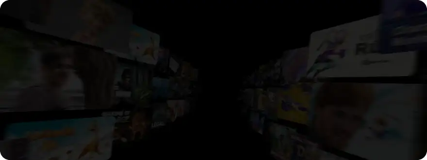</a>
</p>

<p align="center">
  <a href="https://github.com/Hiroyki/play"></a>&nbsp;
  <a href="https://github.com/Hiroyki/play/issues/new"></a>&nbsp;
  <a href="#top"></a>
</p>

<p align="center"><sub>
  Built with <a href="https://github.com/yt-dlp/yt-dlp">yt-dlp</a>, <a href="https://github.com/LuanRT/YouTube.js">YouTube.js</a>, <a href="https://github.com/shaka-project/shaka-player">Shaka Player</a>, <a href="https://expressjs.com">Express</a>, and <a href="https://github.com/Instrument/instrument-sans">Instrument Sans</a>.<br>
  The film, demos, and screenshots show open movies by the <a href="https://studio.blender.org/films/">Blender Foundation</a>, licensed CC BY: Big Buck Bunny, Sintel, Tears of Steel, Spring, Coffee Run, Sprite Fright, Charge, Agent 327, and Wing It!<br>
  Play is not affiliated with YouTube or Google.
</sub></p>
